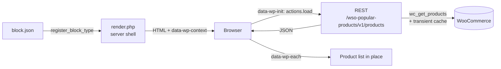

# Popular Products Block

[](https://github.com/MaksymK-web-dev/wso-popular-products/actions/workflows/ci.yml)
[](LICENSE)
[](composer.json)
[](block.json)

A Gutenberg block that lists a store's best-selling WooCommerce products. The list is
fetched from a REST endpoint in the browser and rendered into the existing markup — the
page never reloads, and the block can refresh itself in place.

Registered entirely from `block.json`, built on the Interactivity API, and shipped with no
build step.


## How it works



1. **`block.json` is the source of truth.** Scripts, styles, attributes, the view module
   and the render file are all declared there; PHP registers the block in four lines.
2. **The server renders a shell.** A heading, a toolbar and an empty `<ul>` with a
   `<template data-wp-each="context.products">`. Rendering a real shell (rather than
   nothing) keeps the block visible in the editor preview and gives the Interactivity API a
   hydration target.
3. **`view.js` fetches and patches.** On mount it calls the plugin's REST endpoint and
   writes the result into the block's own context; `data-wp-each` builds the list,
   `data-wp-text` fills the fields, `data-wp-bind--href` sets the links. Refresh is the same
   action again — no navigation, no block re-render.
4. **A REST proxy sits in front of WooCommerce.** The block could call WooCommerce's Store
   API directly; this endpoint exists because the response shape is ours, the result is
   cached in a transient for five minutes, and the route degrades to an empty list instead
   of a fatal error when WooCommerce's blocks package is unavailable.

### Where the REST API is, exactly

Fair question, because the data comes from the same site the block runs on. The block does
REST in both directions:

- **It provides an endpoint** — `register_rest_route( 'wso-popular-products/v1', '/products' )`
  in `ProductsController`, with a permission callback, argument validation and a JSON
  contract.
- **It consumes one** — `fetch( rest_url( 'wso-popular-products/v1/products' ) )` from the
  browser, which is an HTTP round trip against `/wp-json/`, independent of the page render.

What it does *not* do is call a third-party service: the products genuinely live in this
WooCommerce database. Using REST here buys a few real things — the payload survives a page
cache, the browser gets a stable JSON contract instead of rendered HTML, and the same route
serves both the editor preview and the front end.

If the demo needs to prove *external* integration, the natural addition is a second source
fetched the same way: NBU currency rates (`https://bank.gov.ua/NBUStatService/v1/statdirectory/exchange?json`)
is public, needs no key, and would exercise the same client code against a foreign host —
including CORS, which the same-site version never hits.

## Screenshots

### In the editor


The preview uses the same REST endpoint the front end does, so the canvas shows real
products rather than a mock, and the inspector controls (heading, count, price and image
toggles) take effect immediately.

### On the front end


## Installation

Requires WordPress 6.5+, WooCommerce 8.0+, PHP 8.1+.

```bash
cd wp-content/plugins
git clone https://github.com/MaksymK-web-dev/wso-popular-products.git
```

Then activate **Popular Products Block** in *Plugins*, and add the block in the Site
Editor, the post editor, or a template — it is registered under the *Widgets* category.

No build step, no `npm install`: `block.json` points at plain ES modules and the plugin is
usable straight from the clone.

## Configuration

The block has four attributes, all exposed in the inspector:

- **Heading** — text above the list; leave empty to hide it.
- **Number of products** — 1–12, default 3.
- **Show price** — default on.
- **Show image** — default on.

## The endpoint

```
GET /wp-json/wso-popular-products/v1/products?limit=3
```

```json
[
  {
    "id": 13,
    "name": "Smart Learning Tablet",
    "permalink": "https://example.com/?product=smart-learning-tablet",
    "price": "129,00 ₴",
    "image": "https://example.com/wp-content/uploads/2026/11/tablet-300x300.jpg",
    "hasImage": true
  }
]
```

- `limit` is validated and clamped to 1–12; anything else is rejected by the route's
  `validate_callback`.
- Ordering uses `total_sales` meta — WooCommerce keeps lifetime sales there, and
  `wc_get_products()` has no "popularity" argument.
- Results are cached per limit for five minutes; delete the `wso_pp_products_*` transients
  to force a refresh.
- The route is public because it serves the same catalogue the storefront already shows.

## Why no build step

Most blocks assume `@wordpress/scripts`. This one does not, deliberately:

- the plugin has to work when someone clones it and copies the folder into a WordPress
  install — no toolchain, no `node_modules`, no artifact drift;
- the only thing a review needs is readable source;
- the trade-off is paid in two places, both documented: `assets/view.asset.php` is hand
  written, and the editor's attribute list mirrors `block.json`.

`block.json` is also where the Interactivity API is wired: `viewScriptModule` tells
WordPress to load `assets/view.js` as a script module and to emit the import map entry for
`@wordpress/interactivity`.

## Repository layout

```
block.json                 block metadata: script, style, attributes, render
render.php                 server-rendered shell with Interactivity directives
wso-popular-products.php  plugin header + bootstrap
autoload.php               PSR-4 loader for WSO\PopularProducts
src/
  Plugin.php               composition root
  Block/BlockRegistrar.php register_block_type from block.json
  Rest/ProductsController.php  REST route, cache, response shape
  Contract/HookRegistrar.php   hook-owning service
assets/
  edit.js                  editor UI + live preview (no JSX)
  edit.asset.php           editor script dependencies (hand-written)
  view.js                  Interactivity API store and actions
  view.asset.php           script-module dependencies (hand-written)
  style.css, editor.css
tests/Unit/BlockMetadataTest.php
tests/js/editor-registration.test.mjs
docs/screenshots/
```

## Verification status

Verified on WordPress 7.1.4 + WooCommerce 11.3.0 + PHP 8.4, theme Twenty Twenty-Five:

- the block registers and appears with its render callback and view module
  (`WP_Block_Type_Registry`, checked from PHP);
- the rendered page contains the block shell and the `@wordpress/interactivity` import map
  entry, and loads `assets/view.js` as a module;
- **the data is fetched client-side, proven by comparison**: the server HTML contains no
  product names; the DOM after the module runs contains all three products with prices
  formatted as `129,00 ₴` (headless Chrome, DOM dump and screenshot);
- the route returns the expected JSON and clamps `limit`;
- unit tests cover the metadata contract — file references resolve, the view module
  declares its Interactivity dependency, attribute defaults, `supports.html` disabled;
- the editor script registers the block when `wp.*` is available — asserted by
  `tests/js/editor-registration.test.mjs`, which executes `edit.js` against stubbed
  globals and checks the registered name, the attributes and that `save()` is empty.

Not verified:

- the editor canvas has not been exercised in a browser here — the screenshots come from
  the running site's front end; the editor screenshot is captured manually;
- no test covers the REST controller's behaviour against real products (it needs
  WooCommerce loaded);
- no accessibility audit beyond native `<ul>`/`<a>`/`<button>` semantics.

## Naming: why `wso-popular-products`

The folder, text domain and repository name are prefixed deliberately. An earlier version
used `popular-products-block`, which is the slug of an unrelated plugin on WordPress.org
(*Popular Products Block for WooCommerce*, 300+ installs, v2.0.2). WordPress matches update
offers by plugin basename, so the admin showed a pending "update" that would have replaced
this plugin's code with a different one — silently, and without asking.

Two rules follow from that:

- the folder slug is a namespace and has to be unique on WordPress.org;
- the block name stays vendor-prefixed (`wso/popular-products`), so it cannot collide even
  when two blocks with a similar purpose are installed.

## Bugs found while building this

Kept in the README because they are the useful part:

1. **`init` inside `init`.** The plugin booted on `init` and `BlockRegistrar` hooked
   `init` again. PHP did not complain and the block silently never appeared. Registration
   now happens immediately.
2. **Missing asset metadata — twice.** `assets/view.asset.php` and `assets/edit.asset.php`
   both have to exist. Without the first, the view module imports
   `@wordpress/interactivity` with no import-map entry. Without the second, the editor
   script is enqueued with an empty dependency list, `wp.blocks` is undefined, registration
   throws, and the block simply is not in the inserter — the symptom that started this
   fix. `tests/js/editor-registration.test.mjs` now runs the editor script against stubbed
   globals so the registration itself is tested, not assumed.
3. **A slug that already exists on WordPress.org.** The plugin folder was named
   `popular-products-block`, the slug of an unrelated plugin. WordPress offered to "update"
   this one to that plugin's version 2.0.2 — a silent replacement of every file in the
   folder. The plugin is now `wso-popular-products`; see the naming section above.
4. **`get_price_html()` is not text.** Stripping tags left `149,00&nbsp;&#8372;` plus
   screen-reader sentences, and `data-wp-text` set all of it as literal text. Prices are
   now formatted with `wc_price()` and HTML-decoded once.
5. **`const { apiFetch } = wp.apiFetch`.** `wp.apiFetch` is the function itself, not an
   object with a method on it, so destructuring produced `undefined` and the preview threw
   inside its effect — the editor showed "This block has encountered an error and cannot be
   previewed" while the front end kept working. The earlier test missed it because the
   `useEffect` stub never ran the effect body; it now does, and there is a test that invokes
   every component in the tree.
6. **Two blocks on one page shared one list.** State lived in the store
   (`state.products`), and a store is page-global, so pressing Refresh in the first block
   also refreshed the second. State now lives in each block's `data-wp-context`, which is
   per element instance. Verified on a page with two instances: they report 2 and 4
   products, and each keeps its own list.
7. **A newly added product never appeared.** Ordering was `total_sales DESC` alone. On a
   store where nothing has sold yet every product has `total_sales = 0`, so the order was
   whatever the database returned and a fresh product could land past the limit. The
   order is now `total_sales DESC, date DESC` — sales still outrank recency once they exist
   (checked by temporarily setting sales on the oldest product), and otherwise the newest
   product wins instead of losing a tie to chance.
8. **Every image was hidden.** The per-item directive read
   `!context.item.hasImage || !context.showImage`. Inside `data-wp-each` the item context
   shadows the block context, so `context.showImage` was `undefined`, `!undefined` was true,
   and the image was hidden even when the product had one. Whether the element exists is now
   decided in PHP (`$showImage`), and the directive only reads `context.item`.

## License

MIT — see [LICENSE](LICENSE).
