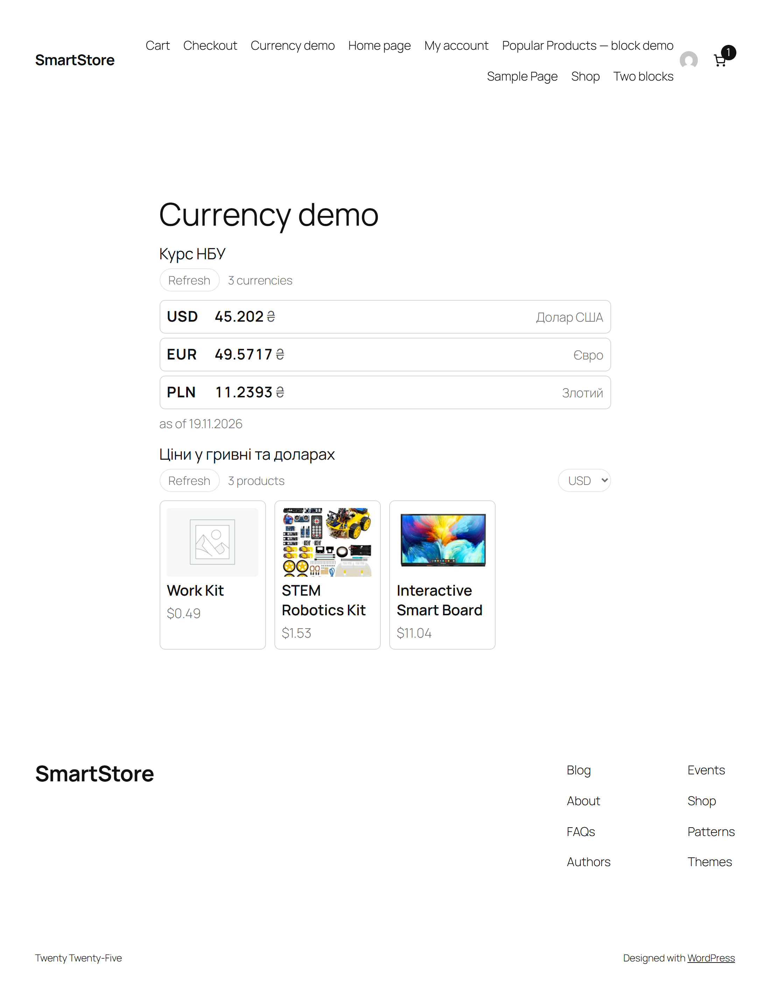
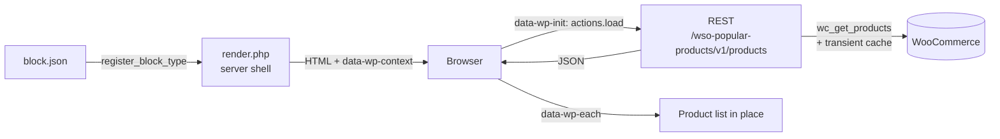
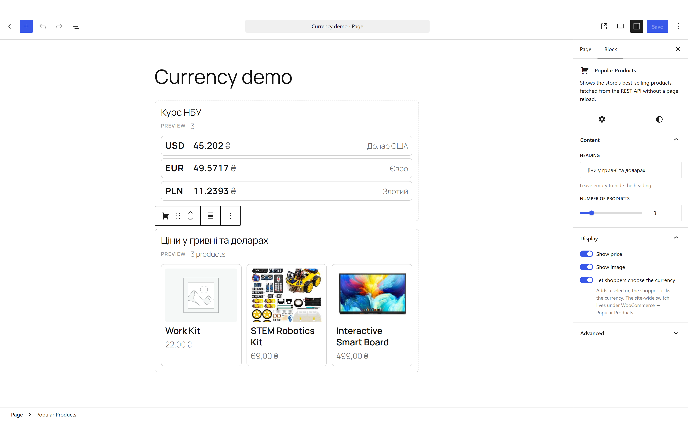

# Popular Products & NBU Rates

[](https://github.com/MaksymK-web-dev/wso-popular-products/actions/workflows/ci.yml)
[](LICENSE)
[](composer.json)
[](blocks/popular-products/block.json)

Two Gutenberg blocks for a WooCommerce storefront, both registered from `block.json`, built
on the Interactivity API, and shipped with no build step:

- **Popular Products** — the store's best-selling products, fetched in the browser and
  rendered into existing markup. Optionally lets a shopper switch every price to USD, EUR
  or PLN at the official NBU rate.
- **NBU Exchange Rates** — today's hryvnia rates from the National Bank of Ukraine, pulled
  from an external API through a cached server-side proxy.



## How it works



1. **`block.json` is the source of truth.** Scripts, styles, attributes, the view module
   and the render file are all declared there; PHP registers the block in four lines.
2. **The server renders a shell.** A heading, a toolbar and an empty `<ul>` with a
   `<template data-wp-each="context.products">`. Rendering a real shell (rather than
   nothing) keeps the block visible in the editor preview and gives the Interactivity API a
   hydration target.
3. **`view.js` fetches and patches.** On mount it calls the plugin's REST endpoint and
   writes the result into the block's own context; `data-wp-each` builds the list,
   `data-wp-text` fills the fields, `data-wp-bind--href` sets the links. Refresh is the same
   action again — no navigation, no block re-render.
4. **A REST proxy sits in front of WooCommerce.** The block could call WooCommerce's Store
   API directly; this endpoint exists because the response shape is ours, the result is
   cached in a transient for five minutes, and the route degrades to an empty list instead
   of a fatal error when WooCommerce's blocks package is unavailable.

### Where the REST API is, exactly

Fair question, because the data comes from the same site the block runs on. The block does
REST in both directions:

- **It provides an endpoint** — `register_rest_route( 'wso-popular-products/v1', '/products' )`
  in `ProductsController`, with a permission callback, argument validation and a JSON
  contract.
- **It consumes one** — `fetch( rest_url( 'wso-popular-products/v1/products' ) )` from the
  browser, which is an HTTP round trip against `/wp-json/`, independent of the page render.

What it does *not* do is call a third-party service for products: those genuinely live in
this WooCommerce database. Using REST here buys a few real things — the payload survives a
page cache, the browser gets a stable JSON contract instead of rendered HTML, and the same
route serves both the editor preview and the front end.

### The external API, and why it is proxied

The rates block is the other direction: it reads
`https://bank.gov.ua/NBUStatService/v1/statdirectory/exchange?json`, which returns about 5 KB
of JSON for ~40 currencies and sends `Access-Control-Allow-Origin: *` — a direct browser
fetch would work.

It still goes through `RatesController` → `RateProvider` on the server, for three reasons:

1. **One cache instead of one request per visitor.** The answer is stored in a transient for
   six hours; the NBU publishes once per working day.
2. **The page survives an outage.** The last successful answer is kept separately (as an
   option with autoload off). If the bank's API is down, the block shows yesterday's rates
   with a note instead of an error.
3. **The response shape is ours.** NBU's field names (`r030`, `txt`, `cc`, `rate`) never
   reach the JavaScript, so a change on their side is one PHP edit.

The cost is one extra hop per cache period. `?codes=USD,EUR` narrows the payload to what a
block displays, and invalid codes are dropped rather than rejected.

## Screenshots

### In the editor



The preview uses the same REST endpoint the front end does, so the canvas shows real
products rather than a mock, and the inspector controls (heading, count, price and image
toggles) take effect immediately.

### On the front end


## Installation

Requires WordPress 6.5+, WooCommerce 8.0+, PHP 8.1+.

```bash
cd wp-content/plugins
git clone https://github.com/MaksymK-web-dev/wso-popular-products.git
```

Then activate **Popular Products Block** in *Plugins*, and add the block in the Site
Editor, the post editor, or a template — it is registered under the *Widgets* category.

No build step, no `npm install`: `block.json` points at plain ES modules and the plugin is
usable straight from the clone.

## Configuration

**Popular Products** exposes six attributes in the inspector:

- **Heading** — text above the list; leave empty to hide it.
- **Number of products** — 1–12, default 3.
- **Show price** — default on.
- **Show image** — default on.
- **Let shoppers show prices in another currency** — adds a toggle button; default off.
- **Convert to** — USD, EUR or PLN; only shown when the toggle is enabled.

**NBU Exchange Rates** exposes three:

- **Heading** — default “Exchange rates”.
- **Currency codes** — comma-separated ISO codes, default `USD,EUR,PLN`; invalid codes are
  dropped and duplicates collapsed.
- **Show the date the rates were published** — default on.

## The endpoints

### Products

```
GET /wp-json/wso-popular-products/v1/products?limit=3
```

```json
[
  {
    "id": 13,
    "name": "Smart Learning Tablet",
    "permalink": "https://example.com/?product=smart-learning-tablet",
    "price": "129,00 ₴",
    "priceValue": 129,
    "currency": "UAH",
    "image": "https://example.com/wp-content/uploads/2026/11/tablet-300x300.jpg",
    "hasImage": true
  }
]
```

- `price` is for display; `priceValue` is for arithmetic. Sending both means the browser
  never has to parse `"129,00 ₴"` back into a number.
- `limit` is validated and clamped to 1–12.
- Ordering is `total_sales DESC, date DESC` — sales first, recency as the tie-break, so a
  newly added product appears on a store that has not sold anything yet.
- Results are cached per limit for five minutes.

### Rates

```
GET /wp-json/wso-popular-products/v1/rates?codes=USD,EUR,PLN
```

```json
{
  "ok": true,
  "base": "UAH",
  "date": "18.11.2026",
  "fetchedAt": 1794945634,
  "stale": false,
  "error": "",
  "rates": {
    "USD": { "code": "USD", "name": "Долар США", "rate": 45.3436 }
  }
}
```

- `ok: false` carries a diagnostic in `error`; the block shows it rather than an empty list.
- `stale: true` means the NBU API was unreachable and a cached answer is being served.
- `codes` is optional; without it the full table is returned. Maximum 12 codes per request.

## Why no build step

Most blocks assume `@wordpress/scripts`. This one does not, deliberately:

- the plugin has to work when someone clones it and copies the folder into a WordPress
  install — no toolchain, no `node_modules`, no artifact drift;
- the only thing a review needs is readable source;
- the trade-off is paid in two places, both documented: `view.asset.php` is hand written,
  and the editor's attribute list mirrors `block.json`.

`block.json` is also where the Interactivity API is wired: `viewScriptModule` tells
WordPress to load `view.js` as a script module and to emit the import map entry for
`@wordpress/interactivity`.

## Repository layout

```
blocks/
  popular-products/        block.json, render.php, edit.js, view.js, CSS, asset files
  nbu-rates/               same shape, independent block
wso-popular-products.php   plugin header + bootstrap
autoload.php               PSR-4 loader for WSO\PopularProducts
src/
  Plugin.php               composition root
  Block/BlockRegistrar.php registers every block in an explicit list
  Contract/HookRegistrar.php   hook-owning service
  Rest/ProductsController.php  products route, cache, response shape
  Rates/RateProvider.php       NBU fetch, normalization, cache, stale fallback
  Rates/RatesController.php    rates route
  Support/Logger.php           WooCommerce log writer
tools/verify-toggle.mjs    end-to-end click test over the Chrome DevTools Protocol
tests/Unit/                metadata contract, coding rules, provider parsing
tests/js/                  editor registration, both blocks
docs/screenshots/
```

## Verification status

Verified on WordPress 7.1.4 + WooCommerce 11.3.0 + PHP 8.4, theme Twenty Twenty-Five.

**Structure and contracts**

- both blocks register with a render callback and a view module (`WP_Block_Type_Registry`);
- the rendered page loads `view.js` as a module and emits the `@wordpress/interactivity`
  import map entry;
- 24 PHP tests and 12 JS tests pass, plus phpcs with WordPress standards;
- metadata tests run per block, driven by the same list `BlockRegistrar` registers — a
  block that exists on disk but is not registered cannot pass unnoticed.

**Behaviour, proven rather than assumed**

- **Data is fetched client-side**: the server HTML contains no product names; the DOM after
  the module runs contains all three products. Same for rates.
- **The currency toggle works**: `tools/verify-toggle.mjs` drives headless Chrome over CDP,
  clicks the button and reads the prices.

  ```
  label before : Show in USD
  prices before: 22,00 ₴ | 69,00 ₴ | 499,00 ₴
  label after  : Show in UAH
  prices after : $0.49 | $1.52 | $11.00
  prices back  : 22,00 ₴ | 69,00 ₴ | 499,00 ₴
  ```

  The arithmetic checks out: 22 / 45.3436 = 0.485 → $0.49.
- **Ordering tie-break**: with every product at zero sales, the newest appears first; with
  sales temporarily set on the oldest product, it still comes first.
- **Two instances stay independent**: a page with `limit 2` and `limit 4` reports
  `2 products` and `4 products`.

**Not verified**

- The editor canvas has not been exercised in a browser here — the editor screenshot is
  captured manually.
- No test covers `ProductsController` against a real WooCommerce query; it is exercised
  through the running site instead.
- The NBU outage path (`stale: true`) is written and unit-testable but has not been
  triggered against a real failure.
- No accessibility audit beyond native `<ul>`/`<a>`/`<button>` semantics.

## Naming: why `wso-popular-products`

The folder, text domain and repository name are prefixed deliberately. An earlier version
used `popular-products-block`, which is the slug of an unrelated plugin on WordPress.org
(*Popular Products Block for WooCommerce*, 300+ installs, v2.0.2). WordPress matches update
offers by plugin basename, so the admin showed a pending "update" that would have replaced
this plugin's code with a different one — silently, and without asking.

Two rules follow from that:

- the folder slug is a namespace and has to be unique on WordPress.org;
- the block name stays vendor-prefixed (`wso/popular-products`), so it cannot collide even
  when two blocks with a similar purpose are installed.

## Bugs found while building this

Kept in the README because they are the useful part:

1. **`init` inside `init`.** The plugin booted on `init` and `BlockRegistrar` hooked
   `init` again. PHP did not complain and the block silently never appeared. Registration
   now happens immediately.
2. **Missing asset metadata — twice.** `assets/view.asset.php` and `assets/edit.asset.php`
   both have to exist. Without the first, the view module imports
   `@wordpress/interactivity` with no import-map entry. Without the second, the editor
   script is enqueued with an empty dependency list, `wp.blocks` is undefined, registration
   throws, and the block simply is not in the inserter — the symptom that started this
   fix. `tests/js/editor-registration.test.mjs` now runs the editor script against stubbed
   globals so the registration itself is tested, not assumed.
3. **A slug that already exists on WordPress.org.** The plugin folder was named
   `popular-products-block`, the slug of an unrelated plugin. WordPress offered to "update"
   this one to that plugin's version 2.0.2 — a silent replacement of every file in the
   folder. The plugin is now `wso-popular-products`; see the naming section above.
4. **`get_price_html()` is not text.** Stripping tags left `149,00&nbsp;&#8372;` plus
   screen-reader sentences, and `data-wp-text` set all of it as literal text. Prices are
   now formatted with `wc_price()` and HTML-decoded once.
5. **`const { apiFetch } = wp.apiFetch`.** `wp.apiFetch` is the function itself, not an
   object with a method on it, so destructuring produced `undefined` and the preview threw
   inside its effect — the editor showed "This block has encountered an error and cannot be
   previewed" while the front end kept working. The earlier test missed it because the
   `useEffect` stub never ran the effect body; it now does, and there is a test that invokes
   every component in the tree.
6. **Two blocks on one page shared one list.** State lived in the store
   (`state.products`), and a store is page-global, so pressing Refresh in the first block
   also refreshed the second. State now lives in each block's `data-wp-context`, which is
   per element instance. Verified on a page with two instances: they report 2 and 4
   products, and each keeps its own list.
7. **A newly added product never appeared.** Ordering was `total_sales DESC` alone. On a
   store where nothing has sold yet every product has `total_sales = 0`, so the order was
   whatever the database returned and a fresh product could land past the limit. The
   order is now `total_sales DESC, date DESC` — sales still outrank recency once they exist
   (checked by temporarily setting sales on the oldest product), and otherwise the newest
   product wins instead of losing a tie to chance.
8. **Every image was hidden.** The per-item directive read
   `!context.item.hasImage || !context.showImage`. Inside `data-wp-each` the item context
   shadows the block context, so `context.showImage` was `undefined`, `!undefined` was true,
   and the image was hidden even when the product had one. Whether the element exists is now
   decided in PHP (`$showImage`), and the directive only reads `context.item`.
9. **An `exit` guard inside a data file truncated the test suite.** `view.asset.php` is a
   `require`d file that returns an array, but it carried the usual
   `defined( 'ABSPATH' ) || exit;` line. Outside WordPress that `exit` terminates the
   *including* process — PHPUnit reported seven tests out of twenty-four and exited with
   status 0, which looks like success. Asset files now return only, and
   `CodingRulesTest::testDataFilesDoNotExit` pins the rule with the reason written down.

## How the conversion is wired

Three decisions worth naming:

- **The server sends both the formatted price and the number.** `price` is `"129,00 ₴"`;
  `priceValue` is `129`. The client never parses a localised string back into a float.
- **`priceText` is derived, not stored twice.** Each product carries `priceText`, recomputed
  from `priceValue` when the toggle flips. There is one source of truth for the number on
  screen.
- **The button sits in the toolbar, not on each card.** It flips the whole block; a button
  per card would imply per-card state that does not exist.

A missing rate is not an error: the prices stay in the store currency and the button stays
`disabled`, with the reason in its `title`.

## License

MIT — see [LICENSE](LICENSE).
