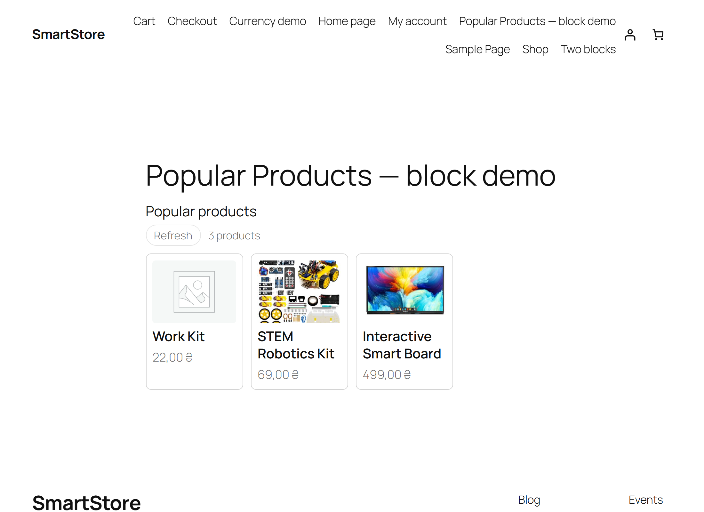
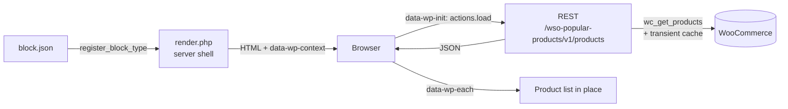

# Popular Products Block

[](https://github.com/MaksymK-web-dev/popular-products-block/actions/workflows/ci.yml)
[](LICENSE)
[](composer.json)
[](block.json)

A Gutenberg block that lists a store's best-selling WooCommerce products. The list is
fetched from a REST endpoint in the browser and rendered into the existing markup — the
page never reloads, and the block can refresh itself in place.

Registered entirely from `block.json`, built on the Interactivity API, and shipped with no
build step.



## How it works



1. **`block.json` is the source of truth.** Scripts, styles, attributes, the view module
   and the render file are all declared there; PHP registers the block in four lines.
2. **The server renders a shell.** A heading, a toolbar and an empty `<ul>` with a
   `<template data-wp-each="state.products">`. Rendering a real shell (rather than nothing)
   keeps the block visible in the editor preview and gives the Interactivity API a
   hydration target.
3. **`view.js` fetches and patches.** On mount it calls the plugin's REST endpoint and
   writes the result to Interactivity store state; `data-wp-each` builds the list,
   `data-wp-text` fills the fields, `data-wp-bind--href` sets the links. Refresh is the same
   action again — no navigation, no block re-render.
4. **A REST proxy sits in front of WooCommerce.** The block could call WooCommerce's Store
   API directly; this endpoint exists because the response shape is ours, the result is
   cached in a transient for five minutes, and the route degrades to an empty list instead
   of a fatal error when WooCommerce's blocks package is unavailable.

## Screenshots

| Editor | Front end |
| --- | --- |
|  |  |

The editor preview uses the same REST endpoint the front end does, so the canvas shows
real products rather than a mock — and the inspector controls (heading, count, price,
image toggles) take effect immediately.

## Installation

Requires WordPress 6.5+, WooCommerce 8.0+, PHP 8.1+.

```bash
cd wp-content/plugins
git clone https://github.com/MaksymK-web-dev/popular-products-block.git
```

Then activate **Popular Products Block** in *Plugins*, and add the block in the Site
Editor, the post editor, or a template — it is registered under the *Widgets* category.

No build step, no `npm install`: `block.json` points at plain ES modules and the plugin is
usable straight from the clone.

## Configuration

The block has four attributes, all exposed in the inspector:

- **Heading** — text above the list; leave empty to hide it.
- **Number of products** — 1–12, default 3.
- **Show price** — default on.
- **Show image** — default on.

## The endpoint

```
GET /wp-json/wso-popular-products/v1/products?limit=3
```

```json
[
  {
    "id": 13,
    "name": "Smart Learning Tablet",
    "permalink": "https://example.com/?product=smart-learning-tablet",
    "price": "129,00 ₴",
    "image": "https://example.com/wp-content/uploads/2026/11/tablet-300x300.jpg",
    "hasImage": true
  }
]
```

- `limit` is validated and clamped to 1–12; anything else is rejected by the route's
  `validate_callback`.
- Ordering uses `total_sales` meta — WooCommerce keeps lifetime sales there, and
  `wc_get_products()` has no "popularity" argument.
- Results are cached per limit for five minutes; delete the `wso_pp_products_*` transients
  to force a refresh.
- The route is public because it serves the same catalogue the storefront already shows.

## Why no build step

Most blocks assume `@wordpress/scripts`. This one does not, deliberately:

- the plugin has to work when someone clones it and copies the folder into a WordPress
  install — no toolchain, no `node_modules`, no artifact drift;
- the only thing a review needs is readable source;
- the trade-off is paid in two places, both documented: `assets/view.asset.php` is hand
  written, and the editor's attribute list mirrors `block.json`.

`block.json` is also where the Interactivity API is wired: `viewScriptModule` tells
WordPress to load `assets/view.js` as a script module and to emit the import map entry for
`@wordpress/interactivity`.

## Repository layout

```
block.json                 block metadata: script, style, attributes, render
render.php                 server-rendered shell with Interactivity directives
popular-products-block.php  plugin header + bootstrap
autoload.php               PSR-4 loader for WSO\PopularProducts
src/
  Plugin.php               composition root
  Block/BlockRegistrar.php register_block_type from block.json
  Rest/ProductsController.php  REST route, cache, response shape
  Contract/HookRegistrar.php   hook-owning service
assets/
  edit.js                  editor UI + live preview (no JSX)
  view.js                  Interactivity API store and actions
  view.asset.php           script-module dependencies (hand-written)
  style.css, editor.css
tests/Unit/BlockMetadataTest.php
docs/screenshots/
```

## Verification status

Verified on WordPress 7.1.4 + WooCommerce 11.3.0 + PHP 8.4, theme Twenty Twenty-Five:

- the block registers and appears with its render callback and view module
  (`WP_Block_Type_Registry`, checked from PHP);
- the rendered page contains the block shell and the `@wordpress/interactivity` import map
  entry, and loads `assets/view.js` as a module;
- **the data is fetched client-side, proven by comparison**: the server HTML contains no
  product names; the DOM after the module runs contains all three products with prices
  formatted as `129,00 ₴` (headless Chrome, DOM dump and screenshot);
- the route returns the expected JSON and clamps `limit`;
- unit tests cover the metadata contract — file references resolve, the view module
  declares its Interactivity dependency, attribute defaults, `supports.html` disabled.

Not verified:

- the editor canvas has not been exercised in a browser here — the screenshots come from
  the running site's front end; the editor screenshot is captured manually;
- no test covers the REST controller's behaviour against real products (it needs
  WooCommerce loaded);
- no accessibility audit beyond native `<ul>`/`<a>`/`<button>` semantics.

## Bugs found while building this

Kept in the README because they are the useful part:

1. **`init` inside `init`.** The plugin booted on `init` and `BlockRegistrar` hooked
   `init` again. PHP did not complain and the block silently never appeared. Registration
   now happens immediately.
2. **Missing asset metadata.** Without `assets/view.asset.php` declaring
   `@wordpress/interactivity`, the module loaded but its import had no import-map entry,
   so nothing ran. The failure is silent in the console of a non-module build.
3. **`get_price_html()` is not text.** Stripping tags left `149,00&nbsp;&#8372;` plus
   screen-reader sentences, and `data-wp-text` set all of it as literal text. Prices are
   now formatted with `wc_price()` and HTML-decoded once.

## License

MIT — see [LICENSE](LICENSE).
